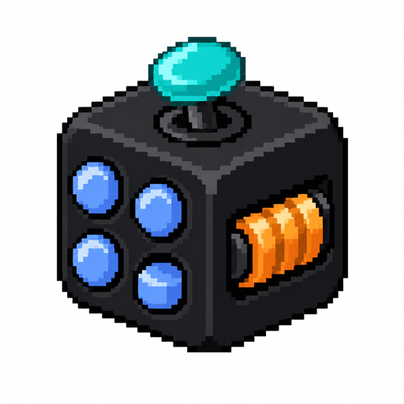
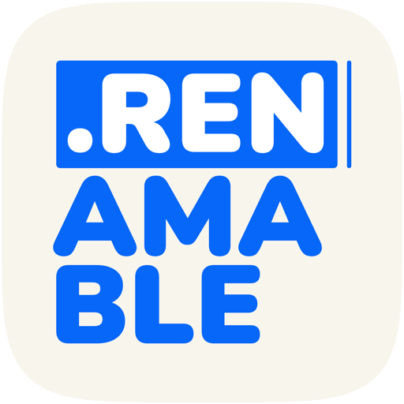
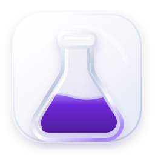
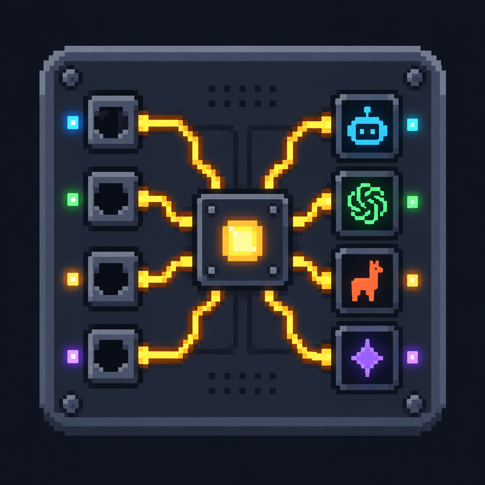
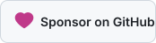

<picture>
  <source media="(prefers-color-scheme: dark)" srcset="./assets/cyber-maker-dark.png">
  <source media="(prefers-color-scheme: light)" srcset="./assets/cyber-maker-light.png">
  
</picture>

 

### Hi, I’m Ruban.

I like turning “surely there’s a better way” into something real.

 

## Currently building

<a href="https://tryfidget.app">
  <picture>
    <source media="(prefers-color-scheme: dark)" srcset="./assets/fidget-icon-dark.png">
    <source media="(prefers-color-scheme: light)" srcset="./assets/fidget-icon-light.png">
    
  </picture>
</a>

### [Fidget](https://tryfidget.app) 

I’m building Fidget, a macOS app that turns your MacBook’s trackpad into tiny
toys you can feel. It opens from the notch for a quick break while AI works,
or whenever you want to fidget.

[Website](https://tryfidget.app)

 

<a href="https://renamable.app">
  <picture>
    <source media="(prefers-color-scheme: dark)" srcset="./assets/renamable-icon-dark.png">
    <source media="(prefers-color-scheme: light)" srcset="./assets/renamable-icon-light.png">
    
  </picture>
</a>

### [Renamable](https://renamable.app) 

A macOS app that converts files when you change their extension in Finder.
Everything stays on your Mac.

[Website](https://renamable.app)

 

## Maintained

### [Let It Brew](https://github.com/ruban-24/letitbrew) 

I maintain Let It Brew, a macOS app that keeps your Mac awake while coding agents work, then lets it sleep when they stop.

[Website](https://letitbrew.app) ·
[Download](https://github.com/ruban-24/letitbrew/releases/latest/download/LetItBrew.dmg) ·
[Source](https://github.com/ruban-24/letitbrew)

 

## Retired

### [Switchboard](https://github.com/ruban-24/switchboard) 

An experimental router exploring System One models for choosing the model and
reasoning effort in Claude Code and Codex.

[Website](https://tryswitchboard.dev) ·
[Why I retired it](https://github.com/ruban-24/switchboard#project-status) ·
[Source](https://github.com/ruban-24/switchboard)

 

### [agex](https://github.com/ruban-24/agex) 

Built for running coding agents in parallel, each in its own Git worktree.
I retired agex as coding agents gained much of this functionality out of the box.

[Why I retired it](https://github.com/ruban-24/agex#project-status) ·
[Source](https://github.com/ruban-24/agex)

## Support my work

If something I’ve built has been useful, you can support whatever I make next.

  &nbsp;
  

## Elsewhere

[LinkedIn](https://www.linkedin.com/in/ruban-bhatia-697295159/) ·
[X](https://x.com/RubanBhatia) ·
[Reddit](https://www.reddit.com/user/rubanbhatia/)

